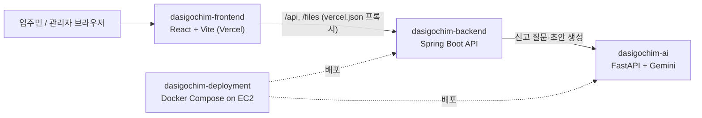

# 다시고침 프론트엔드

**다시고침**은 서울 청년안심주택 입주민을 위한 민원 신고 서비스입니다. 입주민이 불편한 곳을 사진으로 찍으면 AI 챗봇이 상황을 하나씩 되물어 신고서 초안을 써 주고, 입주민은 우리 집 세대나 공용공간의 3D 평면도 위에 위치 핀을 꽂아 신고를 마칩니다. 관리자(전체 관리자 / 지역 담당자 / 단지 관리인)는 담당 구역 범위 안에서 대시보드, 카카오맵 지역·단지 지도, 위험도 색으로 칠한 3D 핀 지도, 신고 관리 화면, 민원 요약 챗봇으로 민원을 살펴보고 처리합니다.

이 저장소는 그중 **웹 프론트엔드**(입주민 앱 + 관리자 앱)입니다. React 19 + Vite + TypeScript + Tailwind CSS로 만들었고, 모든 데이터는 Spring Boot 백엔드의 `/api/v1` REST API로 주고받습니다.

- 배포 주소: https://dasigochim-frontend.vercel.app

## 시스템 구성



프론트엔드는 AI 서버를 직접 부르지 않습니다. 신고 플로우의 AI 질문·초안도 백엔드의 `/api/v1/ai/...` 엔드포인트를 거칩니다.

## 주요 기능

### 입주민 앱 (모바일 화면 기준)

- **홈** (`/home`): 내 신고 / 같은 청년주택 다른 입주민의 신고 탭, 처리 상태 필터, 신고 상세 보기, 알림 패널
- **신고하기** (`/report`): 사진 촬영(카메라 바로 열기) → 상황 메모 → 지역·청년주택·세대(동·호수) 또는 공용공간 선택 → 3D 평면도에 핀 꽂기 → AI 확인 질문에 하나씩 답하기 → 신고서 초안 확인·수정 → 제출
- **프로필 설정** (`/profile`): 이름·연락처·거주 청년주택·동·호수 등록 (처음 신고할 때 안내)

### 관리자 앱 (데스크톱 화면 기준)

- **대시보드** (`/admin`): 담당 구역의 접수·처리 현황, 기간별 처리율·평균 처리일, 최근 6개월 추이, 지연 민원
- **민원 지도** (`/admin?view=map`): 카카오맵 위 시·군·구 / 청년주택별 민원 건수 → 단지 선택 → 공용·거주·주변공간별 민원과 3D 평면도 핀(위험도 색: 높음 빨강 · 중간 주황 · 낮음 노랑, 처리완료는 반투명)
- **신고 관리** (`/admin/reports`): 신고 목록 검색·필터, 통계 카드, 3D 지도 보기
- **신고 상세** (`/admin/reports/:id`): 담당 부서 재배정, 상태·위험도 변경, 조치 내용 입력 후 처리완료, 신고서 파일 생성·열기
- **민원 분석 챗봇**: 화면 오른쪽 아래 떠 있는 챗봇. 지금 보는 범위의 민원을 요약하고, 범위를 바꾸거나 CSV로 내보낼 수 있습니다. (현재는 브라우저에서 등록된 민원을 집계하는 기본 요약이며, AI 서버 연동은 준비 중입니다.)

역할별로 볼 수 있는 구역이 다릅니다. 전체 관리자는 전체, 지역 담당자는 맡은 시·군·구, 단지 관리인은 맡은 단지만 봅니다.

## 빠르게 시작하기

Node.js와 npm이 필요합니다. 로컬에서 백엔드(`dasigochim-backend`)가 함께 떠 있어야 화면에 데이터가 나옵니다.

```bash
npm install
cp .env.example .env.local   # 아래 값을 내 환경에 맞게 고칩니다
npm run dev                  # http://localhost:5175
```

`.env.local` 예시 (실제 키·코드는 절대 커밋하지 마세요. `.env*`는 `.gitignore`에 들어 있습니다):

```dotenv
# API 기본 경로. 로컬은 Vite 프록시를 쓰므로 상대 경로를 권장합니다. (기본값 /api/v1)
VITE_API_BASE_URL=/api/v1

# Vite 개발 서버가 /api, /files 요청을 넘길 백엔드 주소 (기본값 http://127.0.0.1:8080)
# 통합 Docker Compose로 검증할 때는 http://127.0.0.1:8088
VITE_API_PROXY_TARGET=http://127.0.0.1:8080

# 테스트 로그인 버튼 노출 여부. 백엔드 GUEST_LOGIN_ENABLED와 함께 켜야 합니다.
# 현재 화면에서 로그인할 수 있는 방법은 테스트 로그인뿐이라, 끄면 로그인할 수 없어요.
VITE_GUEST_LOGIN_ENABLED=true

# 카카오맵 Web JavaScript 키 (관리자 민원 지도). 없으면 지도 대신 기본 배치 마커를 보여줍니다.
VITE_KAKAO_APP_KEY=your-kakao-javascript-key
```

테스트 로그인에 쓰는 **접근 코드**는 백엔드 설정값입니다. 팀에서 따로 전달받으세요.

## 스크립트

| 명령 | 하는 일 |
| --- | --- |
| `npm run dev` | Vite 개발 서버 실행 (포트 5175, `host: true`로 같은 네트워크의 휴대폰에서도 접속 가능) |
| `npm run build` | `tsc -b`로 타입 검사 후 `vite build`로 `dist/` 생성 |
| `npm run preview` | 빌드 결과물 미리보기 |
| `npm run lint` | ESLint 검사 |

## 폴더 구조

```text
public/
  scenes/        청년주택 3D 평면도 (three.js 단독 HTML, iframe으로 띄움)
src/
  api/           백엔드 REST 클라이언트 (fetch 래퍼, JWT 저장·갱신, 도메인별 API)
  pages/         라우트 단위 화면 (Login, Home, Report, Profile, Admin)
  components/    화면 조각 (admin, report, scene, notification, login, layout, common)
  hooks/         커스텀 훅 (알림 목록 useNotifications)
  lib/           외부 SDK 래퍼 (카카오맵 로더·지오코딩)
  utils/         민원 분류·요약·CSV 내보내기, 3D 핀 색 등
  constants/     위험도·상태·알림 라벨, 테스트 로그인 플래그
  types/         공용 타입 (Report, Building, User 등)
  App.tsx        라우팅과 인증 컨텍스트
  auth.ts        AuthContext / useAuth
  index.css      Tailwind 테마 토큰 (housing.css는 관리자 화면 스타일)
```

## 배포

Vercel에 배포합니다. `vercel.json`이 다음처럼 요청을 넘깁니다.

- `/api/:path*`, `/files/:path*` → EC2의 백엔드로 프록시 (브라우저 입장에서는 같은 도메인이라 CORS 걱정이 없습니다)
- 그 밖의 모든 경로 → `/index.html` (React Router의 클라이언트 라우팅용)

그래서 배포 환경에서도 `VITE_API_BASE_URL`은 기본값 `/api/v1` 그대로 쓰면 됩니다. Vercel 환경 변수에는 `VITE_GUEST_LOGIN_ENABLED`, `VITE_KAKAO_APP_KEY`를 넣고, 카카오 개발자 콘솔에 배포 도메인을 등록해야 지도가 뜹니다.

## 문서

- [기술 스택](readme/tech-stack.md): 의존성 버전, 각 라이브러리를 어디에 쓰는지, 사용하는 브라우저 API
- [아키텍처](readme/architecture.md): 라우트·화면, API 계층, 인증 흐름, 3D 장면 임베드 프로토콜, 관리자 대시보드·챗봇
- [3D 장면 파일 안내](public/scenes/README.md): `public/scenes`의 원본과 덧붙인 연동 스크립트

## 관련 저장소

- 프론트엔드 (이 저장소): https://github.com/anniversary-site/dasigochim-frontend
- 백엔드 (Spring Boot API): https://github.com/anniversary-site/dasigochim-backend
- AI 서버 (FastAPI + Gemini): https://github.com/anniversary-site/dasigochim-ai
- 배포 (Docker Compose on EC2): https://github.com/anniversary-site/dasigochim-deployment
