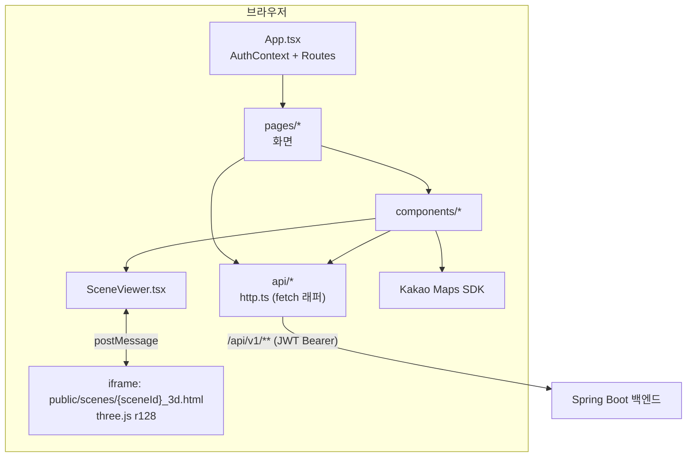
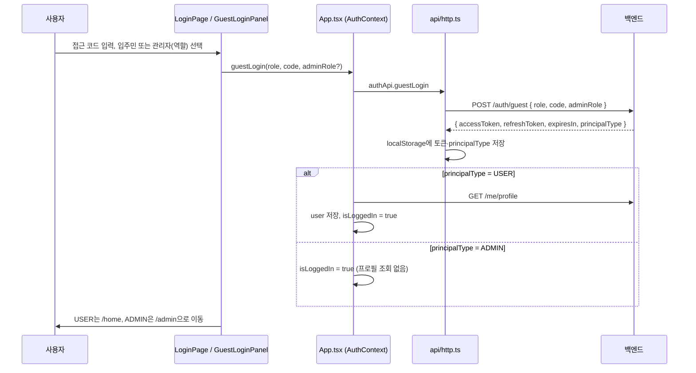
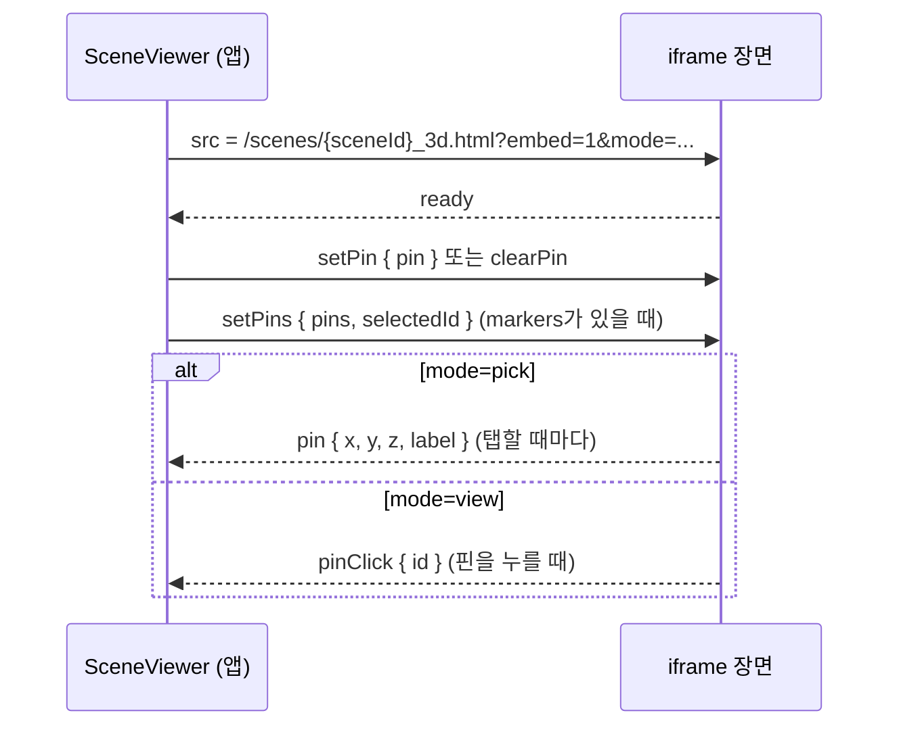

# 아키텍처

다시고침 프론트엔드가 어떻게 짜여 있는지, 화면에서 백엔드와 3D 장면까지 데이터가 어떻게 흐르는지 설명합니다.

[README로 돌아가기](../README.md) · [기술 스택 문서](tech-stack.md)

## 목차

- [전체 구조](#전체-구조)
- [라우트와 화면](#라우트와-화면)
- [주요 컴포넌트](#주요-컴포넌트)
- [API 계층](#api-계층)
- [인증 흐름](#인증-흐름)
- [입주민 신고 플로우](#입주민-신고-플로우)
- [3D 장면 임베드 프로토콜](#3d-장면-임베드-프로토콜)
- [관리자 화면](#관리자-화면)
- [관리자 챗봇 위젯](#관리자-챗봇-위젯)

## 전체 구조

- 상태 관리 라이브러리는 없습니다. 전역 상태는 인증 정보(`AuthContext`) 하나이고, 나머지는 화면이 직접 API를 불러 `useState`에 담습니다.
- 백엔드 응답은 모두 `{ success, data, error }` 래퍼로 오며, `src/api/http.ts`가 이를 풀어 `data`만 돌려줍니다.

## 라우트와 화면

`src/App.tsx`에 정의된 경로입니다.

| 경로 | 화면 (`src/pages/...`) | 가드 | 설명 |
| --- | --- | --- | --- |
| `/` | - | - | `/home`으로 리다이렉트 |
| `/login` | `Login/LoginPage.tsx` | - | 테스트 로그인 패널. 성공하면 입주민은 `/home`, 관리자는 `/admin` |
| `/home` | `Home/HomePage.tsx` | `UserPageGuard` | 내 신고 / 같은 청년주택 신고 / 커뮤니티(준비 중) 탭, 상태 필터, 신고 상세, 알림 |
| `/report` | `Report/ReportFlowPage.tsx` | `UserPageGuard` | 채팅형 신고 플로우 ([아래](#입주민-신고-플로우)) |
| `/profile` | `Profile/ProfileSetupPage.tsx` | `UserPageGuard` | 이름·연락처·청년주택·동·호수 등록 |
| `/admin` | `Admin/HousingAnalysisPage.tsx` | `AdminGuard` | 관리자 첫 화면. `?view=map`이면 민원 지도 탭, 없으면 대시보드 탭 |
| `/admin/reports` | `Admin/AdminDashboardPage.tsx` | `AdminGuard` | 신고 관리 (목록 / 3D 지도 보기) |
| `/admin/reports/:id` | `Admin/AdminReportDetailPage.tsx` | `AdminGuard` | 신고 상세·처리 |
| `/map`, `/my-reports` | - | - | 예전 주소. `/home`으로 리다이렉트 |

가드는 이렇게 동작합니다.

- `UserPageGuard` (`src/pages/UserPageGuard.tsx`): 인증 확인 중이면 "확인 중..."을 보여주고, 관리자 토큰이면 `/admin`으로 보냅니다. 비로그인 사용자를 `/login`으로 보내는 일은 각 화면(`HomePage`, `ProfileSetupPage`)이 `isLoggedIn`을 보고 직접 합니다.
- `AdminGuard` (`src/pages/Admin/AdminGuard.tsx`): 로그인하지 않았거나 주체 유형이 `ADMIN`이 아니면 `/login`으로 보냅니다.
- 홈에서 "신고하기"를 눌렀을 때 `user.profileCompleted`가 아니면 `/profile`로 먼저 보내고, 저장이 끝나면 `state.from`(`/report`)으로 돌아옵니다.

## 주요 컴포넌트

| 폴더 | 컴포넌트 | 역할 |
| --- | --- | --- |
| `components/scene` | `SceneViewer` | 3D 장면 iframe 래퍼. pick / view 모드, 단일 핀·여러 핀 |
| `components/admin` | `AreaDashboard` | 관리자 대시보드 본문 (기간 필터, 처리율, 평균 처리일, 6개월 추이, 지연 민원, 청년주택별 현황) |
| | `RegionKakaoMap` | 카카오맵 위 시·군·구 / 청년주택 민원 건수 마커 |
| | `AdminBuildingScene3D` | 한 단지의 3D 장면에 신고 핀을 전부 띄우고 전체/미처리·월별로 거름 |
| | `AdminSpaceMapView` | 신고 관리 화면의 "3D 지도" 보기. 단지를 고르고 `AdminBuildingScene3D`를 띄움 (마지막 단지는 `localStorage`에 기억) |
| | `AdminChatWidget` | 오른쪽 아래 민원 분석 챗봇 |
| | `AdminTopNav` | 상단 메뉴: 대시보드 / 민원 지도 / 신고 관리, 마이페이지, 로그아웃 |
| | `AdminSidebar`, `AdminStatCard`, `AdminRiskCell`, `AdminStatusBadge`, `SpaceAnalysisSections` | 신고 관리·분석 화면 조각 |
| `components/report` | `MyReportCard`, `ReportDetailView` | 입주민 홈의 신고 카드와 상세 (3D 핀 위치를 view 모드로 보여줌) |
| `components/notification` | `NotificationPanel`, `NotificationItem` 등 | 알림 목록 (`hooks/useNotifications.ts`와 함께 사용) |
| `components/login` | `GuestLoginPanel` | 접근 코드 입력 + 입주민 / 관리자(역할 선택) 체험 |
| `components/common` | `RiskBadge`, `ReportStatusBadge`, `FilterChip`, `BrandMark` 등 | 공용 UI |

화면과 무관한 로직은 `src/utils`에 있습니다.

- `reportMarker.ts`: 3D 핀 색 (`HIGH` `#e5484d` 빨강, `MEDIUM` `#f2994a` 주황, `LOW` `#e8b931` 노랑), 처리완료는 반투명(`faded`)
- `spaceCategorySummary.ts`: 신고를 공용공간 / 거주공간 / 주변공간으로 분류
- `reportDescription.ts`: 신고 본문(`description`)에서 민원 원문·분석 메타 꺼내기
- `complaintChatAnswer.ts`: 관리자 챗봇의 집계 답변과 CSV 내보내기

## API 계층

`src/api/`는 백엔드 REST API를 감싼 얇은 클라이언트입니다. 화면은 `import { reportApi, adminApi } from "@/api"`처럼 `src/api/index.ts`를 통해 가져다 씁니다.

### `http.ts`: 공통 요청 함수

- 기본 경로: `VITE_API_BASE_URL` 또는 `/api/v1`. 로컬은 Vite 프록시, 배포는 `vercel.json` 리라이트가 백엔드로 넘깁니다.
- `http.get / post / patch / del` 네 가지 메서드를 제공합니다.
- 요청할 때 `localStorage`의 access token을 `Authorization: Bearer ...`로 붙입니다. 본문이 `FormData`면 `Content-Type`을 비워 브라우저가 multipart 경계를 정하게 합니다.
- 응답 래퍼 `{ success, data, error: { code, message } }`를 풀어 `data`를 돌려주고, 실패하면 `ApiException(message, code, status)`를 던집니다.
- **401 처리**: refresh token이 있으면 `POST /auth/refresh`로 토큰을 갱신하고 원래 요청을 한 번만 다시 보냅니다. 갱신에 실패하면 토큰을 지우고 `window`에 `dasigochim:unauthorized` 이벤트를 쏩니다. `App.tsx`가 이 이벤트를 듣고 로그아웃합니다.
- `resolveApiAssetUrl()`: 백엔드가 주는 `/files/...` 상대 경로를 API가 다른 도메인일 때 절대 URL로 바꿉니다.
- 페이지 응답 타입 `Page<T>`: `{ content, totalElements, totalPages, page, size }` (page는 0부터)

### 도메인별 모듈

| 파일 | 객체 | 주요 엔드포인트 (`/api/v1` 기준) |
| --- | --- | --- |
| `auth.ts` | `authApi` | `POST /auth/guest`(테스트 로그인), `POST /auth/refresh`, `POST /admin/auth/login`(정의만 있고 현재 화면에서는 쓰지 않음), `logout()`은 토큰 삭제 |
| `me.ts` | `meApi` | `GET/PATCH /me/profile`, `GET /me/reports`, `GET /me/notifications`, `PATCH /me/notifications/{id}/read` |
| `reports.ts` | `reportApi` | `GET /reports/feed?filter=mine\|others`, `POST /reports/draft`, `POST /reports/{id}/photos`, `PATCH /reports/{id}/location`, `PATCH /reports/{id}`, `POST /reports/{id}/report-file`, `POST /reports/{id}/submit`, `DELETE /reports/{id}` 등 |
| `ai.ts` | `aiApi` | `POST /ai/report-flow/next-question`, `POST /ai/report-flow/draft` (그 밖에 `analyze-content`, `draft-from-text` 정의) |
| `buildings.ts` | `buildingApi` | `GET /buildings/regions`, `GET /buildings?sido=&sigungu=`, `GET /buildings/{id}`, `GET /buildings/{id}/spaces`, `GET /buildings/{id}/units`, `GET /buildings/{id}/units/lookup?ho=&dong=` |
| `admin.ts` | `adminApi` | `GET /admin/me`, `GET /admin/stats/summary`, `GET /admin/departments`, `GET /admin/reports`, `GET /admin/reports/{id}`, `GET /admin/buildings/{id}/space-map`, `GET·POST /admin/reports/{id}/report-file`, `PATCH .../status`, `PATCH .../department`, `PATCH .../risk-level`, `POST .../resolve`, `GET /admin/notifications`, `PATCH /admin/notifications/{id}/read` |

`adminApi.me()`는 예전 백엔드처럼 `name`만 오는 경우를 대비해, 역할·구역이 비어 있으면 전체 관리자(`SUPER`, "전국")로 채웁니다.

## 인증 흐름

현재 화면에서 쓰는 로그인은 **테스트(게스트) 로그인** 하나입니다. `VITE_GUEST_LOGIN_ENABLED=true`이고 백엔드의 `GUEST_LOGIN_ENABLED`도 켜져 있어야 합니다.

- **역할**: `role`은 `USER` 또는 `ADMIN`입니다. 관리자는 `adminRole`로 `SUPER`(전체 관리자, 전국) / `REGION`(지역 담당자, 패널 예시는 서울특별시 마포구) / `BUILDING`(단지 관리인, 패널 예시는 공덕역 청년안심주택 e·seo) 중 하나를 고릅니다 (`src/components/login/GuestLoginPanel.tsx`).
- **저장 위치** (`src/api/http.ts`의 `tokenStore`): `localStorage`의 `dasigochim_access_token`, `dasigochim_refresh_token`, `dasigochim_principal_type`
- **새로고침했을 때**: `App.tsx`가 처음 마운트될 때 access token이 있으면 `principalType`을 읽고, `ADMIN`이면 바로 로그인 상태로, `USER`면 `/me/profile`을 불러 확인합니다. 실패하면 로그아웃합니다. 확인이 끝날 때까지 `isAuthLoading`이 `true`라서 가드가 "확인 중..."을 보여줍니다.
- **토큰 만료**: 위 [API 계층](#api-계층)의 401 처리대로 자동 갱신하고, 갱신도 실패하면 `dasigochim:unauthorized` 이벤트로 로그아웃합니다.
- **로그아웃**: `authApi.logout()`이 `localStorage`의 세 값을 지우고, 컨텍스트의 `user` / `principalType` / `isLoggedIn`을 초기화합니다.
- **관리자 담당 범위**: 신고 목록은 백엔드가 담당 범위로 걸러서 줍니다. 프론트는 추가로 `/admin/me`의 `scopes`를 보고 범위 밖 단지·지역을 화면 선택지에서 뺍니다 (`HousingAnalysisPage.tsx`의 `inScope`, `rootOf`).

## 입주민 신고 플로우

`src/pages/Report/ReportFlowPage.tsx`는 채팅처럼 진행되는 한 화면입니다. 단계(`Stage`)는 `photo → compose → region → housing → spaceKind → unitInput | commonSelect | manualLocation → scene → afterLocation → question → proposal` 순서로 넘어가며, 단계마다 직전 상태를 스냅샷으로 남겨 뒤로가기로 되돌릴 수 있습니다.

1. **사진** (`photo`): 카메라(`capture="environment"`)나 앨범에서 사진을 고르고, `URL.createObjectURL`로 미리 봅니다.
2. **메모** (`compose`): 상황을 글로 적어 보내면 `POST /reports/draft`로 임시 신고를 만들고 `POST /reports/{id}/photos`로 사진을 올립니다. 같은 사진은 다시 올리지 않습니다.
3. **위치**: 지역 → 청년주택 → 세대 내부 / 공용공간을 고릅니다.
   - 세대 내부: 동·호수를 입력하면 `GET /buildings/{id}/units`(목록) 또는 `.../units/lookup`으로 세대 타입과 `sceneId`를 찾습니다.
   - 공용공간: `GET /buildings/{id}/spaces`에서 공간을 고릅니다.
   - 3D 평면도가 없는 단지는 위치를 글로 적습니다 (`manualLocation`).
4. **핀** (`scene`): `SceneViewer`를 `mode="pick"`으로 띄워 탭한 곳에 핀을 꽂고, `PATCH /reports/{id}/location`에 `sceneId`, `pinX/Y/Z`, `pinLabel`(핀 근처 공간 이름) 등을 저장합니다.
5. **AI 확인 질문** (`question`): `POST /ai/report-flow/next-question`으로 질문을 **하나씩** 받습니다. 지금까지의 질문·답변을 함께 보내므로 다음 질문은 앞선 답을 반영합니다. 보기 버튼으로 답하거나, `allowCustom`이면 직접 입력합니다. 마지막 질문(`last`)에 답하면 `POST /ai/report-flow/draft`로 요약·위험 내용·개선 제안 초안을 받습니다.
6. **신고서 확인** (`proposal`): 위험 내용과 개선 제안을 고칠 수 있습니다. 제출하면 `PATCH /reports/{id}`(요약·본문, 실명 신고) → `POST /reports/{id}/report-file`(신고서 파일 생성) → `POST /reports/{id}/submit` 순서로 부르고 `/home`으로 돌아갑니다.

닫기 버튼으로 나가거나 뒤로가기로 사진 단계까지 돌아가면 `DELETE /reports/{id}`로 임시 신고를 지웁니다.

## 3D 장면 임베드 프로토콜

### 파일과 sceneId

- 위치: `public/scenes/{sceneId}_3d.html` (세대 타입, 층, 공용공간별 독립 HTML, three.js r128 CDN 사용)
- `sceneId`는 백엔드의 `building_units.scene_id`, `building_spaces.scene_id`, `reports.scene_id`와 짝입니다 (`public/scenes/README.md`). 예: `unit_19-type`, `sangsu_common_1F`, `hapjeong_floor_3-18F`
- 각 파일 끝에 앱 연동 스크립트가 붙어 있습니다. 쿼리에 `embed`가 없으면 아무 일도 하지 않아 단독으로 열어 볼 수도 있습니다.

### URL 파라미터

`SceneViewer`는 항상 `/scenes/{sceneId}_3d.html?embed=1&mode={pick|view}`로 iframe을 엽니다.

| 파라미터 | 동작 |
| --- | --- |
| `embed=1` | 장면 자체 버튼·안내 문구를 숨기고(`body.capture`), 공간 이름 라벨을 켭니다. 연동 스크립트가 활성화됩니다. |
| `mode=pick` | 화면을 탭하면(6px 넘게 끌면 회전으로 보고 무시) `Raycaster`로 맞은 지점에 핀을 꽂고 좌표를 부모로 보냅니다. |
| `mode=view` (pick이 아닌 모든 값) | 핀을 보여주기만 하고, `setPins`로 띄운 여러 핀 중 하나를 누르면 `pinClick`을 보냅니다. |

### 메시지 형식

모든 메시지에는 출처 표시 `source`가 붙고, 받는 쪽은 `source`가 맞지 않으면 무시합니다.

**앱 → 장면** (`source: "dasigochim-app"`)

| `type` | 내용 | 용도 |
| --- | --- | --- |
| `setPin` | `pin: { x, y, z }` | 핀 하나 표시 (신고 위치 보기, pick 모드의 현재 핀) |
| `clearPin` | - | 핀 하나 숨기기 |
| `setPins` | `pins: [{ id, x, y, z, color, faded? }]`, `selectedId` | 여러 핀 표시 (관리자 3D 지도). `color`는 위험도 색, `faded`면 반투명(처리완료), `selectedId` 핀은 1.45배 크게 |

**장면 → 앱** (`source: "dasigochim-scene"`)

| `type` | 내용 | 언제 |
| --- | --- | --- |
| `ready` | - | 연동 스크립트 초기화가 끝났을 때 |
| `pin` | `pin: { x, y, z, label }` | pick 모드에서 탭했을 때. 좌표는 소수 셋째 자리까지, `label`은 가장 가까운 공간 라벨 이름(없으면 `null`) |
| `pinClick` | `id` | view 모드에서 여러 핀 중 하나를 눌렀을 때 |

### 주고받는 순서

`src/components/scene/SceneViewer.tsx`의 구현 포인트:

- `ready`를 받기 전에는 "3D 공간을 불러오는 중..." 오버레이를 덮고 메시지를 보내지 않습니다. 준비된 장면 id를 기억하므로 `sceneId`가 바뀌면 자연히 다시 준비 전 상태가 됩니다 (iframe에 `key={sceneId}`).
- 받은 메시지는 `event.source`가 자기 iframe의 `contentWindow`인지 확인합니다. 한 화면에 장면이 여러 개 있어도 섞이지 않습니다.
- 보낼 때는 대상 origin을 `window.location.origin`으로 지정합니다 (장면은 같은 출처의 `public/` 파일).
- `pin`, `markers`, `selectedId` props가 바뀔 때마다 `setPin` / `clearPin` / `setPins`를 다시 보냅니다.

사용처:

| 화면 | 모드 | 핀 |
| --- | --- | --- |
| `ReportFlowPage` 위치 고르기 | `pick` | 단일 핀 (`onPin`으로 좌표 수신) |
| `ReportFlowPage` 채팅 기록, `ReportDetailView`, `AdminReportDetailPage` | `view` | 저장된 단일 핀 |
| `AdminBuildingScene3D`, `HousingAnalysisPage`의 공용공간 3D | `view` | 여러 핀 (`markers`, 누르면 신고 상세로 이동) |

## 관리자 화면

### 첫 화면: `/admin` (`HousingAnalysisPage.tsx`)

- 처음 들어오면 `buildingApi.regions()`, `buildingApi.list()`, `adminApi.me()`와 함께 `adminApi.reports({ size: 100 })`를 부르고, `totalPages`만큼 나머지 페이지를 이어 받아 담당 범위의 신고 전부를 메모리에 올립니다. 대시보드·지도·챗봇이 이 목록을 함께 씁니다.
- 시작 범위는 역할에 따라 다릅니다 (`rootOf`). 전체 관리자는 서울특별시 전체, 지역 담당자는 맡은 시·도(시·군·구가 하나면 거기까지), 단지 관리인은 맡은 단지에서 시작합니다.
- 상단 필터로 시·도 → 시·군·구 → 청년주택을 고르고 조회합니다.
- **대시보드 탭** (`AreaDashboard.tsx`): 기간(이번 달 / 최근 30일 / 최근 3개월 / 전체)별 접수·처리완료, 처리율, 평균 처리일, 미처리 중 위험도 높음, 7일 넘게 처리되지 않은 지연 민원, 최근 6개월 접수·처리 추이, 공간 유형별 분포, 청년주택별(단지 하나면 공간별) 현황 표(미처리 많은 순, 주택 이름을 누르면 그 주택으로 조회)
- **민원 지도 탭** (`?view=map`): 단지를 고르기 전에는 `RegionKakaoMap`으로 시·군·구 또는 청년주택별 민원 건수를 지도에 띄웁니다. 단지를 고르면 공용공간 / 거주공간 / 주변공간 카테고리로 나눠 봅니다. 거주공간은 세대 타입별 3D 장면(`AdminBuildingScene3D`), 공용공간은 공간을 골라 `SceneViewer`에 여러 핀으로 띄우고, 핀이나 목록을 누르면 `/admin/reports/:id`로 갑니다.

### 신고 관리: `/admin/reports` (`AdminDashboardPage.tsx`)

- `statsSummary`(접수·검토·처리완료·오늘 신규)와 부서별 대기 건수를 카드·사이드바로 보여줍니다.
- 신고 목록은 상태·부서·검색어로 거르고 최신순으로 페이지 단위 조회합니다 (`GET /admin/reports`).
- "3D 지도" 보기로 바꾸면 `AdminSpaceMapView`가 단지를 골라 `AdminBuildingScene3D`를 띄웁니다. 핀 색은 위험도, 처리완료는 반투명입니다.
- 관리자 알림은 `useNotifications(true, "admin")`으로 불러옵니다.

### 신고 상세: `/admin/reports/:id` (`AdminReportDetailPage.tsx`)

- 사진, 내용, 위치(3D 장면이 있으면 `SceneViewer` view 모드로 핀 표시)를 보여줍니다.
- 담당 부서 재배정, 상태 변경, 위험도(높음·중간·낮음) 변경, 조치 내용을 적고 처리완료를 할 수 있습니다.
- 신고서 파일을 생성해 `resolveApiAssetUrl`로 주소를 맞춘 뒤 새 탭에서 엽니다.

## 관리자 챗봇 위젯

`src/components/admin/AdminChatWidget.tsx`는 관리자 첫 화면(`/admin`) 오른쪽 아래에 떠 있는 "민원 분석 AI" 버튼과 대화창입니다.

> 지금 버전은 **AI 서버를 부르지 않습니다.** 첫 화면이 이미 불러온 신고 목록을 브라우저에서 집계해 답합니다 (`src/utils/complaintChatAnswer.ts`). 대화창 아래에도 "AI 연동 준비 중"이라고 안내합니다.

- **범위**: 열 때 지금 화면의 범위(`pageScope`: 시·도, 시·군·구, 청년주택, 공간 유형)로 시작합니다. 화면 범위가 바뀐 뒤 다시 열면 새로 시작합니다.
- **범위 바꾸기**: "범위 바꾸기" 버튼을 누르면 시·도 → 시·군·구 → 청년주택 → 공간 유형(공용공간 / 거주공간 / 주변공간) 순서로 버튼을 고릅니다. 선택지에는 민원 건수가 함께 붙습니다. 청년주택·시·군·구·시·도 이름을 직접 입력해도 찾아갑니다.
- **추천 질문**: "가장 많은 민원", "주요 불편 이유", "미처리 민원", "엑셀로 정리"
- **답변 방식** (`answerComplaintQuestion`)
  - 기본: 범위의 민원 수, 가장 많은 민원 요약 상위 3개, 처리완료·미처리 건수, 여러 단지면 민원이 많은 주택
  - "미처리", "처리": 미처리 건수와 그중 위험도 높음, 많이 남은 유형
  - "이유", "불편", "유형", "어디": 공간 유형별 분포, 불편이 몰리는 곳(세대 민원은 핀 라벨로 방 이름 집계), 자주 나오는 문제
  - "엑셀", "csv": `exportComplaintsCsv`로 CSV를 내려받습니다.
- **CSV 내보내기**: 열은 번호, 청년주택, 민원, 공간, 위험도, 상태, 접수일, 원문, 공간 유형, 근본 요구, 근본 요구 코드, 표면 요청입니다. 엑셀에서 한글이 깨지지 않도록 UTF-8 BOM을 붙이고, `= + @ -` 등으로 시작하는 값 앞에 `'`를 붙여 수식 주입을 막습니다. 파일 이름은 `{범위}-민원.csv`입니다.
